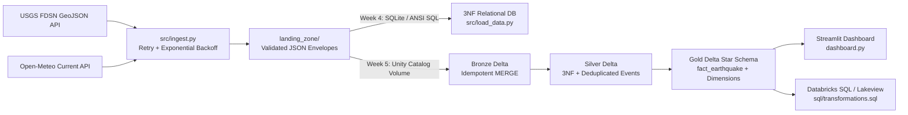
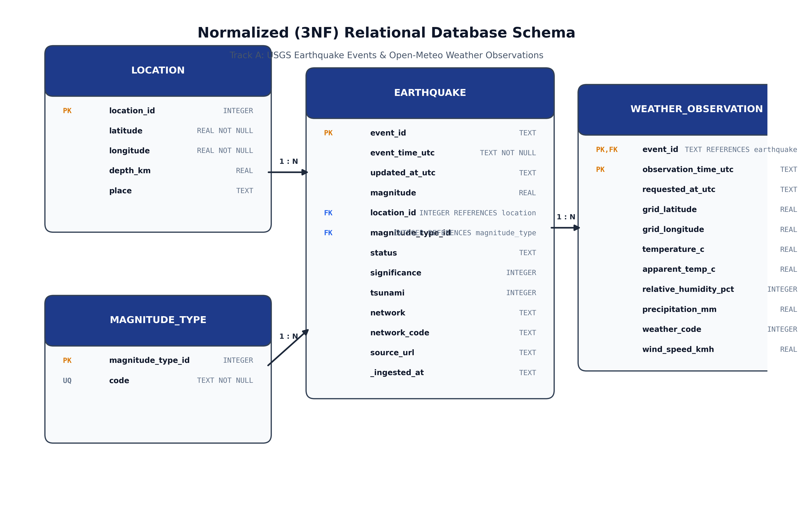
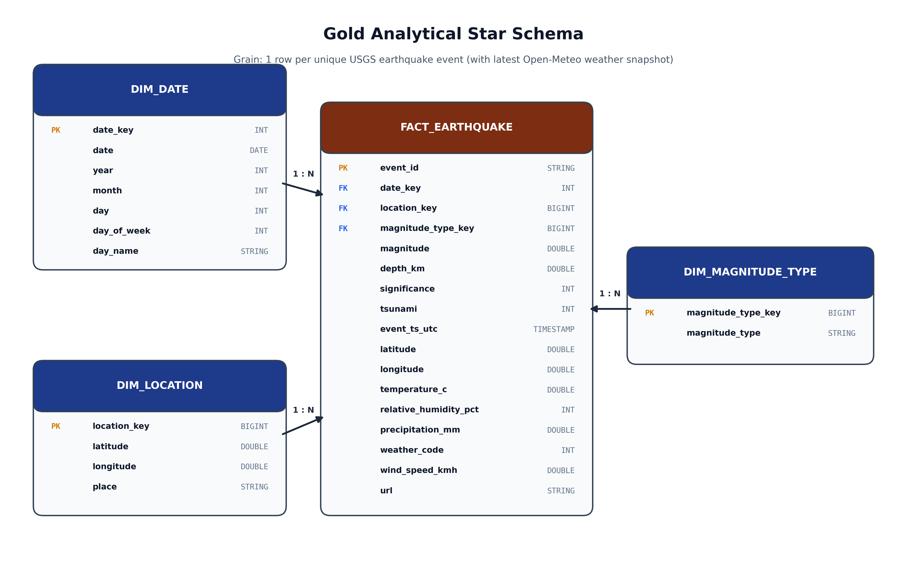

# Earthquake & Weather Alerts — Real-Time Data Intelligence Platform (Track A)

An end-to-end Data Engineering capstone project that ingests live seismic events from the **USGS FDSN GeoJSON API** and surface weather snapshots from the **Open-Meteo API**, lands raw JSON envelopes, loads a normalized **3NF relational schema**, transforms data through a **Medallion Architecture (Bronze → Silver → Gold Star Schema)** using **PySpark & Delta Lake on Databricks**, and surfaces insights via an interactive **Streamlit analytical dashboard**.

---

## Architecture & Medallion Flow



See [`docs/architecture.md`](docs/architecture.md) for detailed layer contracts.

---

## Repository Structure

```text
├── dashboard.py                      # Functioning Streamlit dashboard connected to Gold Star Schema
├── databricks.yml                    # Databricks Asset Bundle (DAB) config (Serverless Standard v6)
├── databricks_job.json               # Databricks Workflows scheduled job definition
├── earthquake_pipeline_notebook.py   # Self-contained Databricks notebook (Bronze -> Silver -> Gold)
├── requirements.txt                  # Python dependencies (ingestion + Streamlit dashboard)
├── landing_zone/
│   └── sample_data.json              # Verified live API capture (USGS + Open-Meteo)
├── src/
│   ├── ingest.py                     # API ingestion with backoff, jitter, Retry-After & validation
│   ├── load_data.py                  # Week 4 loader: JSON -> normalized 3NF SQLite tables
│   ├── simulate_pipeline.py          # Local Bronze -> Silver -> Gold Star Schema simulator
│   ├── transform_bronze.py           # PySpark Bronze Delta MERGE ingestion
│   ├── transform_silver.py           # PySpark Silver 3NF + deduplication Delta MERGE
│   ├── transform_gold.py             # PySpark Gold Star Schema Delta MERGE
│   └── run_pipeline.py               # Databricks spark-submit / Python task entrypoint
├── sql/
│   ├── create_tables.sql             # Week 4: ANSI/SQLite normalized 3NF DDL
│   ├── databricks_delta_tables.sql   # Week 5: Databricks Unity Catalog Delta Lake DDL
│   └── transformations.sql           # Analytical Gold SQL queries
├── docs/
│   ├── er_diagram.png                # Normalized 3NF ER diagram
│   ├── er_diagram.md                 # Mermaid 3NF ER diagram
│   ├── schema_documentation.md       # 3NF data dictionary & normalization proofs
│   ├── deduplication_strategy.md     # Deduplication & Delta MERGE strategy
│   ├── star_schema.png               # Gold analytical Star Schema diagram
│   ├── star_schema.md                # Star Schema grain, keys & integrity notes
│   ├── dashboard_spec.md             # Databricks AI/BI Lakeview dashboard spec
│   ├── analytical_dashboard.html     # Standalone static HTML analytical report
│   ├── analytical_insights_report.md # Written analytical insights & query results
│   └── demo_guide.md                 # 5-minute demo script
├── scripts/
│   ├── generate_erd_image.py         # Generates docs/er_diagram.png
│   ├── generate_star_schema_image.py # Generates docs/star_schema.png
│   ├── build_dashboard_html.py       # Generates docs/analytical_dashboard.html
│   └── upload_to_volume.sh           # Uploads landing_zone/*.json to Unity Catalog Volume
└── tests/
    ├── test_pipeline.py              # Week 4 unit & contract tests (5 tests)
    └── test_week5_pipeline.py        # Week 5 Medallion, Star Schema & Dashboard tests (7 tests)
```

---

## Database Design & Diagrams

### 1. Normalized 3NF Schema (Week 4 & Silver Layer)
- **Entities:** `location`, `magnitude_type`, `earthquake`, `weather_observation`
- **DDL:** [`sql/create_tables.sql`](sql/create_tables.sql)
- **Documentation:** [`docs/schema_documentation.md`](docs/schema_documentation.md) | [`docs/er_diagram.md`](docs/er_diagram.md)



### 2. Gold Analytical Star Schema (Week 5)
- **Grain:** 1 row per unique USGS `event_id` in `gold.fact_earthquake`, enriched with the latest available Open-Meteo weather snapshot.
- **Dimensions:** `gold.dim_date` (`date_key`), `gold.dim_location` (`location_key`), `gold.dim_magnitude_type` (`magnitude_type_key`).
- **DDL:** [`sql/databricks_delta_tables.sql`](sql/databricks_delta_tables.sql)
- **Documentation:** [`docs/star_schema.md`](docs/star_schema.md)



---

## Local Execution Instructions

### 1. Setup & Week 4 Ingestion + 3NF Load
```bash
python3 -m venv .venv
source .venv/bin/activate       # Windows: .venv\Scripts\activate
python3 -m pip install -r requirements.txt

# Fetch live USGS earthquakes & Open-Meteo weather snapshots
python3 src/ingest.py --period day --min-magnitude 2.5 --limit 100 --weather-limit 25

# Load raw JSON into normalized 3NF SQLite tables
python3 src/load_data.py landing_zone --db earthquake_3nf.db
```

### 2. Run Local Week 5 Medallion Simulation & Analytical Dashboard
```bash
# Run local Bronze -> Silver -> Gold simulation and print Gold analytics
python3 src/simulate_pipeline.py

# Launch the interactive Streamlit analytical dashboard
streamlit run dashboard.py
```
To connect `dashboard.py` directly to a live Databricks SQL Warehouse instead of local Gold tables, set `DATABRICKS_SERVER_HOSTNAME`, `DATABRICKS_HTTP_PATH`, and `DATABRICKS_TOKEN` in your environment (never commit credentials).

---

## Databricks Implementation & Execution

All Delta Lake tables use **Unity Catalog** (`workspace.bronze`, `workspace.silver`, `workspace.gold`) and idempotent **Delta `MERGE`** operations (`DeltaTable.forName(...).merge(...)`).

1. **Create Volume & Upload Landing Data:**
   - Ensure catalog `workspace` exists; the notebook runs `CREATE SCHEMA IF NOT EXISTS` for `bronze`, `silver`, `gold` and `CREATE VOLUME IF NOT EXISTS workspace.bronze.landing`.
   - Upload `landing_zone/sample_data.json` (or live `run_*.json` files) to `/Volumes/workspace/bronze/landing/` via the Databricks UI or `./scripts/upload_to_volume.sh`.
2. **Run the Self-Contained Notebook:**
   - Import [`earthquake_pipeline_notebook.py`](earthquake_pipeline_notebook.py) into your Databricks Workspace.
   - Select **Serverless Standard v6** compute and click **Run All**.
3. **Schedule with Databricks Workflows / Asset Bundles:**
   - Via DAB: `databricks bundle deploy` (uses [`databricks.yml`](databricks.yml)).
   - Via Jobs API/CLI: update `<your-databricks-username>` in [`databricks_job.json`](databricks_job.json) and run `databricks jobs create --json @databricks_job.json`.
4. **Run Gold Analytics SQL:**
   - Execute [`sql/transformations.sql`](sql/transformations.sql) in the Databricks SQL Editor or build the Lakeview dashboard per [`docs/dashboard_spec.md`](docs/dashboard_spec.md).

---

## Verification & Testing Results

Locally verified with `python3 -m pytest -v tests/`:
- **Week 4 Tests (`tests/test_pipeline.py` — 5/5 PASSED):** Genuine live sample validation, pre-save API validation, ANSI SQL DDL execution, 3NF foreign-key integrity (`PRAGMA foreign_key_check`), and deduplication idempotency.
- **Week 5 Tests (`tests/test_week5_pipeline.py` — 7/7 PASSED):** PySpark & notebook AST/syntax + Delta `MERGE` contract verification, Databricks job/bundle config validation, Bronze counts, Silver deduplication & coordinate quality filtering, Gold Star Schema grain & referential integrity, Gold analytical queries, and Streamlit `AppTest` rendering.
- **Note on Databricks Execution:** PySpark and Delta Lake execution in a live Databricks workspace has not been run from this local environment (no Databricks CLI/workspace credentials configured locally) and must be executed manually in Databricks using the steps above.
