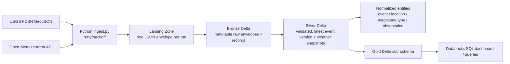

# Architecture and data contracts

## Layers

- **Landing/Bronze:** retain source JSON, run ID, ingestion timestamp and file path. Bronze appends every run for replay and audit.
- **Silver:** parse GeoJSON coordinates into longitude, latitude and depth; reject missing event IDs/times and invalid coordinate ranges; choose the row with greatest USGS `updated` timestamp for each event ID. Weather snapshots are keyed by event and provider observation timestamp; repeated pulls of the same key keep the latest request.
- **Normalized 3NF target:** earthquake event references location and magnitude type entities; weather observations reference the event. See `sql/create_tables.sql`. The runnable PySpark job materializes those normalized tables and also maintains a wide Silver event table (`silver.earthquakes`) as a transformation convenience for Gold.
- **Gold:** `fact_earthquake` has one row per event and latest available weather snapshot, with date, location and magnitude type dimensions. `dim_location` uses a deterministic hash key based on source location attributes.

Weather is a *current/forecast grid-cell snapshot at ingestion time*, not reconstructed historical weather at the earthquake origin time. Keep `observation_ts_utc` to make this temporal distinction visible; the Gold fact attaches the latest captured snapshot.

## Idempotency and deduplication

Bronze is append-only, so reruns are never silently discarded. In Silver, earthquake natural key is USGS `feature.id`; select the greatest `properties.updated`, with ingestion time as tie-breaker. Weather natural key is `(event_id, current.time)`; retain latest `requested_at`. A late-arriving USGS update therefore replaces the prior Silver representation. For a production incremental job, implement these same rules in Delta `MERGE` keyed by event ID / observation key rather than overwrite; the sample job overwrites curated tables for simpler classroom reruns.

## Limits and units

Weather calls default to at most 25 events per ingestion run. USGS defaults to one day and magnitude 2.5+, configurable via CLI. Open-Meteo grid coordinates can differ from requested quake coordinates. Temperature is °C, precipitation is mm, wind speed defaults to km/h, coordinates use WGS84 longitude/latitude. No credential is required for these public endpoints; respect provider usage terms and rate limits.
