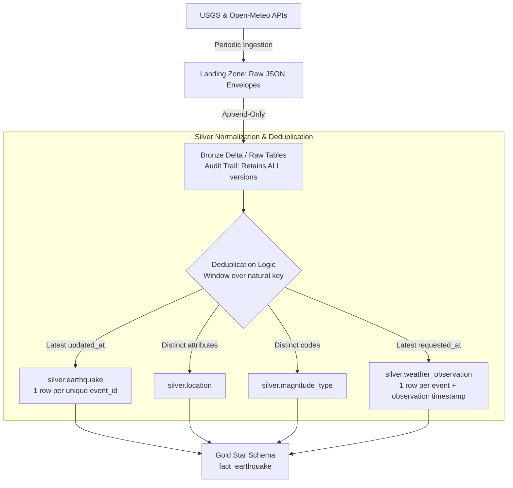

# Deduplication Strategy for Recurring and Updated Events

This document details the deduplication, versioning, and idempotency strategy implemented across the ingestion and transformation layers for USGS earthquakes and Open-Meteo weather snapshots.

---

## 1. Why Deduplication Is Critical

1. **Seismic Sensor Network Updates (USGS):**
   - When an earthquake occurs, automated seismic instruments immediately emit preliminary records (status: `automatic`).
   - Over subsequent hours and days, seismologists review waveforms, recalculating epicenter coordinates, depth, magnitude, and felt reports, updating the record (status: `reviewed`).
   - Recurring API queries (e.g. hourly or daily lookbacks) repeatedly fetch the same earthquake `id` with higher `properties.updated` timestamps and revised attributes.
2. **Dynamic Meteorological Observations (Open-Meteo):**
   - Atmospheric grid model forecasts and station observations update on 15-to-60-minute cycles.
   - If an earthquake from yesterday is polled again today, the weather endpoint returns an updated snapshot.
3. **Pipeline Re-runs and Batch Idempotency:**
   - Pipeline re-runs or backfills must produce deterministic, duplicate-free tables without silently multiplying event counts.

---

## 2. Natural Keys & Version Identifiers

| Entity | Natural Primary Key | Version / Ordering Key | Tie-Breaker |
| :--- | :--- | :--- | :--- |
| **Earthquake (`silver.earthquake`)** | `event_id` (`feature.id`) | `properties.updated` (Epoch ms) | `_ingested_at` (UTC timestamp) |
| **Weather (`silver.weather_observation`)** | `(event_id, observation_time_utc)` | `requested_at` (UTC timestamp) | `run_id` |
| **Location (`silver.location`)** | Deterministic hash of `(lat, lon, depth, place)` | N/A (Immutable entity) | Distinct set |
| **Magnitude Type (`silver.magnitude_type`)** | `code` (e.g., `md`, `ml`, `mb`, `mww`) | N/A (Standard code list) | Distinct set |

---

## 3. Multi-Layer Deduplication Architecture



---

## 4. Implementation Details

### A. Bronze Layer: Append-Only Immutable Replay Log
Bronze tables (`bronze.ingestion_runs`, `bronze.earthquake_events`, `bronze.weather_snapshots`) are **strictly append-only**:
- Every run appends raw source JSON envelopes alongside technical metadata (`run_id`, `_ingested_at`, `_source_file`).
- No deduplication occurs in Bronze. This guarantees an untampered historical log for compliance, audit, and disaster replay.

### B. Silver Layer: Windowed Deduplication (Batch Refreshes)
In PySpark and SQL, deduplication is executed using standard window functions:

```python
# Partition by natural event key, order by USGS update timestamp descending
w_quake = Window.partitionBy("event_id").orderBy(
    F.col("updated_ms").desc_nulls_last(),
    F.col("_ingested_at").desc()
)

deduped_earthquakes = (
    parsed_bronze_df
    .withColumn("rn", F.row_number().over(w_quake))
    .filter("rn = 1")
    .drop("rn")
)
```

For weather observations:
```python
# Deduplicate weather by event and observation timestamp
w_weather = Window.partitionBy("event_id", "observation_ts_utc").orderBy(
    F.col("requested_at").desc_nulls_last()
)

deduped_weather = (
    parsed_weather_df
    .withColumn("rn", F.row_number().over(w_weather))
    .filter("rn = 1")
    .drop("rn")
)
```

### C. Incremental Production Deployments: Delta `MERGE`
For continuous streaming or incremental jobs, the classroom full overwrite is replaced with an idempotent Delta Lake `MERGE`:

```sql
MERGE INTO workspace.silver.earthquake AS target
USING silver_staged_updates AS source
ON target.event_id = source.event_id
WHEN MATCHED AND source.updated_at_utc > target.updated_at_utc THEN
  UPDATE SET
    target.event_time_utc   = source.event_time_utc,
    target.updated_at_utc   = source.updated_at_utc,
    target.magnitude        = source.magnitude,
    target.location_id      = source.location_id,
    target.magnitude_type_id = source.magnitude_type_id,
    target.status           = source.status,
    target.significance     = source.significance,
    target.tsunami          = source.tsunami,
    target.network          = source.network,
    target.network_code     = source.network_code,
    target.source_url       = source.source_url,
    target._ingested_at     = source._ingested_at
WHEN NOT MATCHED THEN
  INSERT (
    event_id, event_time_utc, updated_at_utc, magnitude,
    location_id, magnitude_type_id, status, significance,
    tsunami, network, network_code, source_url, _ingested_at
  )
  VALUES (
    source.event_id, source.event_time_utc, source.updated_at_utc, source.magnitude,
    source.location_id, source.magnitude_type_id, source.status, source.significance,
    source.tsunami, source.network, source.network_code, source.source_url, source._ingested_at
  );
```

---

## 5. End-to-End Trace Example

| Ingestion Run | File Name | Event ID | USGS Status | Magnitude | `updated` (Epoch ms) | Action Taken in Silver |
| :--- | :--- | :--- | :--- | :--- | :--- | :--- |
| **Run 1 (08:00 UTC)** | `run_20261112T080000Z.json` | `us7000twu1` | `automatic` | 4.2 | `1794080000000` | Inserted as active version |
| **Run 2 (12:00 UTC)** | `run_20261112T120000Z.json` | `us7000twu1` | `reviewed`  | 4.4 | `1794095000000` | **Replaces** Run 1 version (higher `updated`) |
| **Run 3 (18:00 UTC)** | `run_20261112T180000Z.json` | `us7000twu1` | `reviewed`  | 4.4 | `1794095000000` | **Ignored** as duplicate (tie-breaker keeps existing) |

Result: `silver.earthquake` contains exactly **1 row** for `us7000twu1` with `magnitude = 4.4` and `status = 'reviewed'`.

