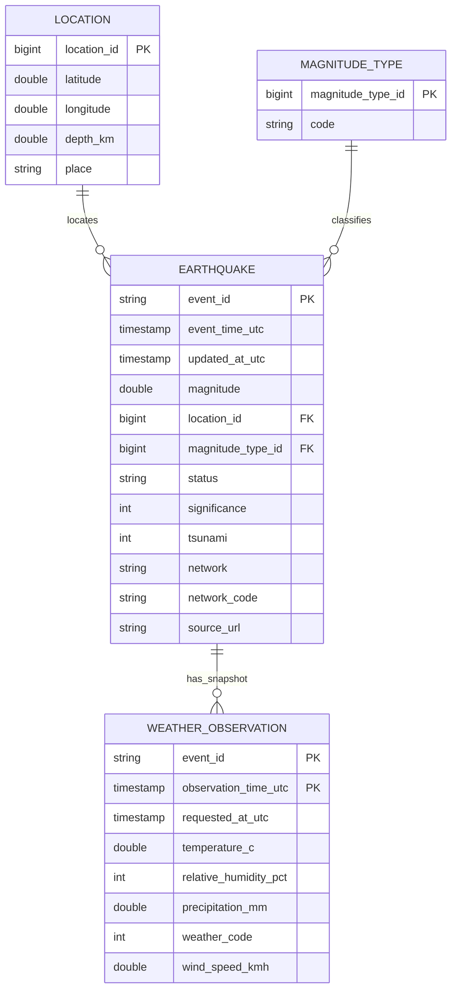

# Normalized 3NF ER diagram

Location and magnitude code attributes are stored once; each weather snapshot is an observation associated with an event. Delta key declarations are informational, so the job logic enforces uniqueness.
