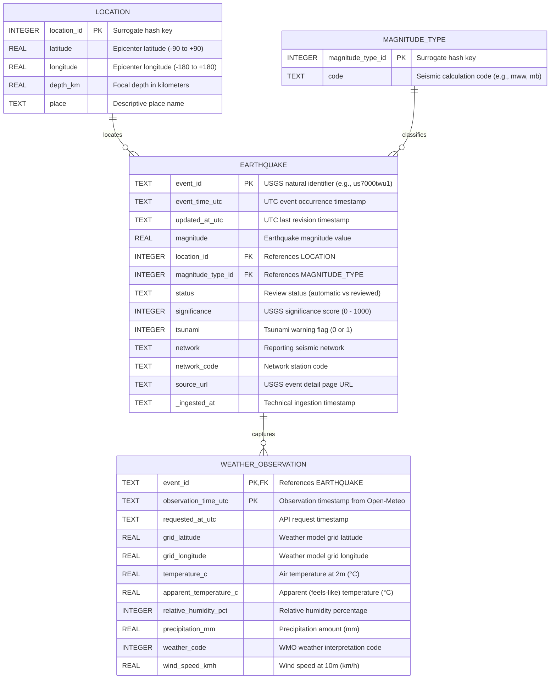

# Normalized (3NF) Relational Schema Documentation

This document provides the formal data dictionary, architectural justification, and Third Normal Form (3NF) proofs for the **Earthquake & Weather Intelligence Pipeline**.

---

## 1. Schema Overview

The relational schema decouples raw, semi-structured USGS GeoJSON features and Open-Meteo meteorological payloads into four normalized entities:
1. `location`: Distinct geographic epicenter coordinates, depth, and descriptive place name.
2. `magnitude_type`: Standard seismic measurement and calculation methods (e.g., `mb`, `mww`, `ml`, `md`).
3. `earthquake`: Core seismic event occurrences with magnitude, significance, status, and network sources.
4. `weather_observation`: Time-stamped surface weather conditions captured at the epicenter coordinates.

---

## 2. Entity Relationship Diagram (ERD)

---

## 3. Data Dictionary

### Table: `location`
Stores distinct spatial locations. Isolating spatial coordinates avoids duplicating coordinate strings and depths across recurring seismic sequences (aftershocks) at the same fault location.

| Column Name | Data Type | Nullable | Key | Description |
| :--- | :--- | :---: | :---: | :--- |
| `location_id` | `INTEGER` | No | PK | Deterministic surrogate key generated from `(latitude, longitude, depth_km, place)`. |
| `latitude` | `REAL` | No | - | Latitude coordinate in WGS 84 degrees ($-90.0 \le \text{lat} \le 90.0$). |
| `longitude` | `REAL` | No | - | Longitude coordinate in WGS 84 degrees ($-180.0 \le \text{lon} \le 180.0$). |
| `depth_km` | `REAL` | Yes | - | Focal depth in kilometers below sea level. |
| `place` | `TEXT` | Yes | - | Human-readable geographic label (e.g., `"10 km NW of Hamakita, Japan"`). |

### Table: `magnitude_type`
Lookup dimension for seismological magnitude calculation scales.

| Column Name | Data Type | Nullable | Key | Description |
| :--- | :--- | :---: | :---: | :--- |
| `magnitude_type_id` | `INTEGER` | No | PK | Deterministic surrogate key generated from `code`. |
| `code` | `TEXT` | No | Unique | Standard USGS magnitude scale code (`mb`: body wave, `mww`: moment tensor, `ml`: local/Richter, `md`: duration). |

### Table: `earthquake`
Core transactional entity representing seismic events.

| Column Name | Data Type | Nullable | Key | Description |
| :--- | :--- | :---: | :---: | :--- |
| `event_id` | `TEXT` | No | PK | Unique natural identifier assigned by USGS (e.g., `"pr71538728"`). |
| `event_time_utc` | `TEXT` | No | - | ISO-8601 UTC timestamp of the earthquake origin time. |
| `updated_at_utc` | `TEXT` | Yes | - | ISO-8601 UTC timestamp of the last revision by seismologists. |
| `magnitude` | `REAL` | Yes | - | Reported magnitude value on the associated scale. |
| `location_id` | `INTEGER` | No | FK | Foreign key referencing `location(location_id)`. |
| `magnitude_type_id`| `INTEGER` | No | FK | Foreign key referencing `magnitude_type(magnitude_type_id)`. |
| `status` | `TEXT` | Yes | - | Processing status (`"automatic"` from automated detection or `"reviewed"` by human analysts). |
| `significance` | `INTEGER` | Yes | - | Calculated significance rating (0 to 1000). |
| `tsunami` | `INTEGER` | No | - | Binary flag: `1` if oceanic tsunami alert issued, `0` otherwise. |
| `network` | `TEXT` | Yes | - | Primary contributing seismic network (e.g., `"us"`, `"pr"`, `"ci"`). |
| `network_code` | `TEXT` | Yes | - | Network event identifier code. |
| `source_url` | `TEXT` | Yes | - | Direct web link to the official USGS event detail page. |
| `_ingested_at` | `TEXT` | No | - | Technical metadata tracking when the record was ingested into the pipeline. |

### Table: `weather_observation`
Time-variant meteorological observations associated with earthquake epicenters.

| Column Name | Data Type | Nullable | Key | Description |
| :--- | :--- | :---: | :---: | :--- |
| `event_id` | `TEXT` | No | PK, FK | Foreign key referencing `earthquake(event_id)`. |
| `observation_time_utc` | `TEXT` | No | PK | Timestamp of meteorological observation reported by Open-Meteo. |
| `requested_at_utc` | `TEXT` | No | - | Timestamp when the pipeline requested the weather snapshot. |
| `grid_latitude` | `REAL` | Yes | - | Open-Meteo weather model grid point latitude. |
| `grid_longitude`| `REAL` | Yes | - | Open-Meteo weather model grid point longitude. |
| `temperature_c` | `REAL` | Yes | - | Surface air temperature at 2 meters above ground (°C). |
| `apparent_temperature_c` | `REAL` | Yes | - | Apparent (wind-chill / heat-index) temperature (°C). |
| `relative_humidity_pct` | `INTEGER` | Yes | - | Relative humidity percentage ($0 - 100\%$). |
| `precipitation_mm` | `REAL` | Yes | - | Liquid precipitation equivalent (mm). |
| `weather_code` | `INTEGER` | Yes | - | WMO weather interpretation code (0: Clear, 1-3: Cloudy, 51-65: Rain, etc.). |
| `wind_speed_kmh` | `REAL` | Yes | - | Surface wind speed at 10 meters (km/h). |

---

## 4. Normalization Justification (1NF, 2NF, 3NF Proof)

### First Normal Form (1NF) Compliance
* **Atomicity:** All attributes contain atomic, scalar values. Complex GeoJSON coordinate arrays `[-67.062, 17.966, 8.03]` are unpacked into discrete atomic columns (`longitude`, `latitude`, `depth_km`).
* **No Repeating Groups:** Multi-value objects (such as multiple weather measurements over time) are stored as separate rows in a child table, rather than comma-separated lists or embedded arrays.
* **Unique Identification:** Every table possesses a defined primary key (`event_id`, `location_id`, `magnitude_type_id`, and composite `(event_id, observation_time_utc)`).

### Second Normal Form (2NF) Compliance
* **Pre-condition:** Schema is in 1NF.
* **No Partial Dependencies:** In `weather_observation`, the composite candidate key is `(event_id, observation_time_utc)`. Every meteorological attribute (`temperature_c`, `precipitation_mm`, `weather_code`) depends on *both* the specific event and the observation time. In all single-key tables (`earthquake`, `location`, `magnitude_type`), partial dependencies cannot mathematically exist.

### Third Normal Form (3NF) Compliance
* **Pre-condition:** Schema is in 2NF.
* **No Transitive Dependencies ($X \to Y \to Z$):**
  1. *Spatial Attributes:* In an unnormalized event table, `event_id -> place -> (latitude, longitude)`. The geographical coordinates and descriptions depend on the physical location, not the seismic event itself. Moving `latitude`, `longitude`, `depth_km`, and `place` into `location` eliminates this transitive dependency.
  2. *Magnitude Methodology:* `event_id -> magnitude -> magType description`. The magnitude code (`mb`, `mww`) classifies the instrumentation method, not the event. Normalizing into `magnitude_type` eliminates redundant string storage and ensures reference integrity.
  3. *Meteorological Observations:* Atmospheric weather fluctuates independently of underground seismic fault ruptures. By modeling `weather_observation` as an observation entity tied to the event, weather attributes do not depend transitively on event attributes.

---

## 5. Referential Integrity & Constraints

1. **Foreign Key Enforcement:**
   * `earthquake.location_id` $\to$ `location.location_id`
   * `earthquake.magnitude_type_id` $\to$ `magnitude_type.magnitude_type_id`
   * `weather_observation.event_id` $\to$ `earthquake.event_id`
2. **Domain Boundary Checks:**
   * Latitude: $-90.0 \le \text{lat} \le 90.0$
   * Longitude: $-180.0 \le \text{lon} \le 180.0$
   * Tsunami flag: $\{0, 1\}$
3. **Repeatable Execution (Idempotency):**
   * Primary key declarations and unique constraints guarantee that multiple pipeline runs overwrite or update existing entities deterministically without generating duplicate records.

