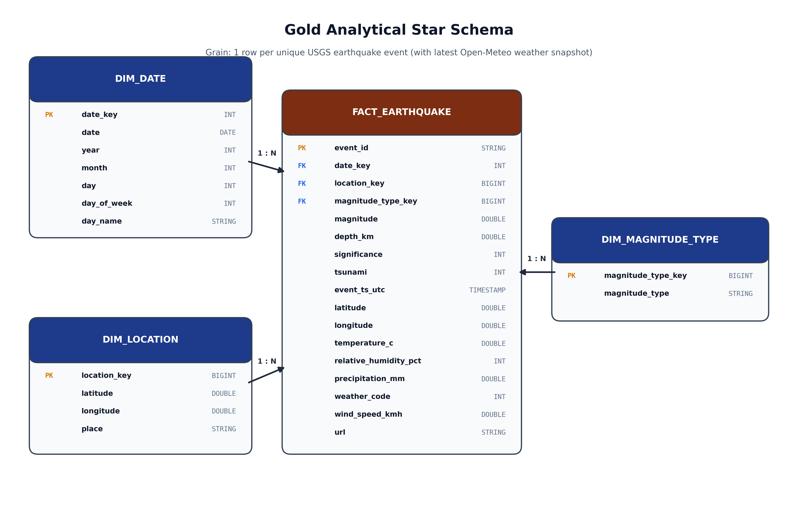
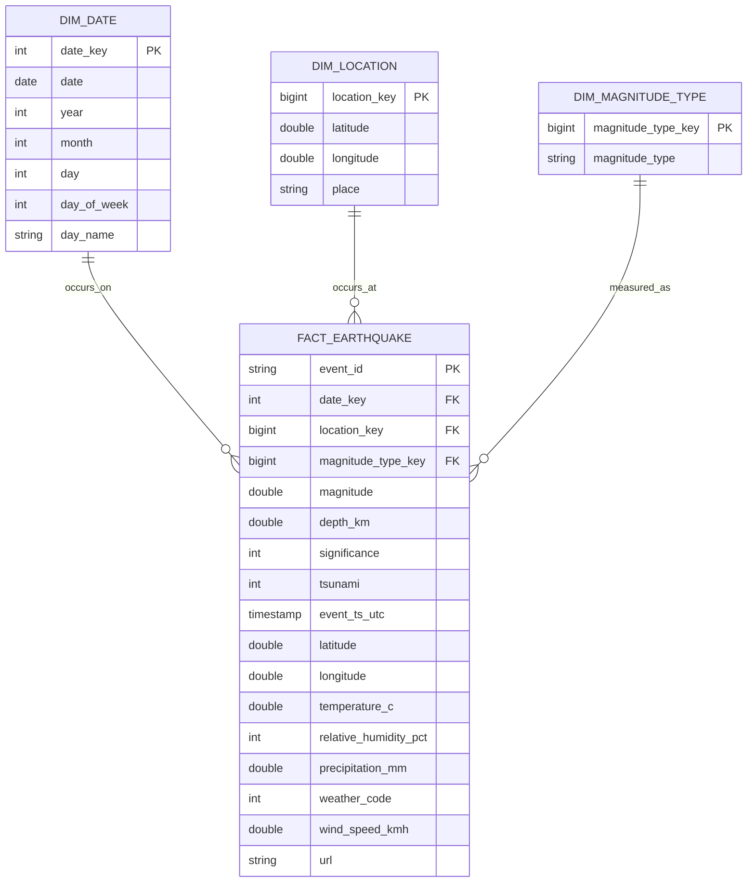

# Gold Star Schema Documentation

## Star Schema Design Verification

- **Fact Table Grain:** Exactly **one row per unique USGS earthquake event (`event_id`)**.
- **Dimension Surrogate Keys:**
  - `date_key`: Deterministic `yyyyMMdd` integer derived from `event_ts_utc`.
  - `location_key`: Deterministic 64-bit `xxhash64(latitude, longitude, place)`.
  - `magnitude_type_key`: Deterministic 64-bit `xxhash64(magnitude_type)`.
- **Measures:** `magnitude`, `depth_km`, `significance`, `tsunami`, `temperature_c`, `relative_humidity_pct`, `precipitation_mm`, `wind_speed_kmh`.
- **Referential Integrity & Null Handling:** Nullable `place` and `magnitude_type` values are coalesced to `"Unknown"` / `"unknown"` prior to key generation and joins, ensuring zero orphaned foreign keys in `fact_earthquake`. Unmatched weather snapshots remain `NULL` without dropping earthquake events.
- **Duplicate Handling:** Upstream Silver deduplicates by latest `properties.updated` (tie-broken by `_ingested_at`). Gold attaches the single latest weather snapshot (`requested_at` descending) per `event_id` and uses Delta `MERGE` keyed on `event_id`.
